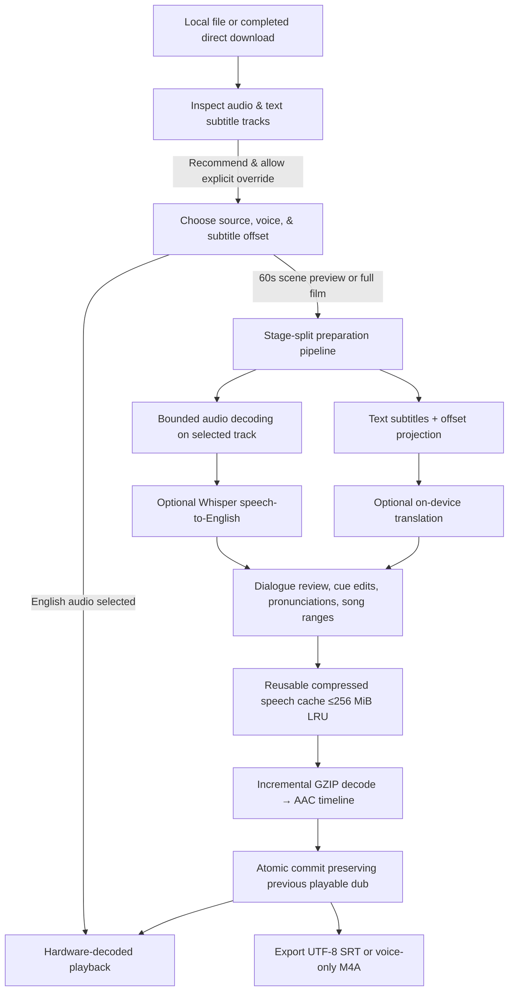

# Architecture

EnglishDub is one Kotlin/Android Views application. It has no web runtime, account system, inference backend, or video re-encoding step.

## Boundaries

- **UI:** a persistent header and RecyclerView library with `WRAP_CONTENT` accessible (`>=48dp`) controls supporting large system fonts and TalkBack. Room emits library and queue changes; a diff updates changed cards.
- **Admission and queue:** `PreparationCoordinator` reserves a numbered owner before requesting Android service startup. `PreparationService` processes one film at a time and continues through eligible `queued` jobs within the active foreground session, pausing safely on user action, charger disconnect under charging-only mode, severe thermal status, or Android `onTimeout`.
- **Media inspection and recommendation:** `AudioTools.inspectTracks` enumerates audio and supported text-subtitle tracks with ISO language normalization and an `"Unknown language"` fallback. `AudioTools.recommendSource` prioritizes existing English audio, English subtitles, translated subtitles (Hindi/Urdu/Tamil), and finally speech recognition, while honoring explicit user overrides and never silently switching audio tracks.
- **Dialogue pipeline:** `DialoguePipeline` is decoupled from the Android `Service` lifecycle. It applies pronunciation replacements (`Pronunciation.apply`) to spoken text only (keeping normal spelling in captions and SRT exports), skips synthesis for `subtitlesOnly` cues and manual `PreservedRange` song sections, recalculates downstream cue placement (`DubTiming.place`), and commits timelines atomically so failed regeneration preserves the previous playable dub.
- **Speech recognition and transcripts:** `DialogueRecognizer` owns a model and accepts an exclusively borrowed direct audio buffer. Speech-mode cues set `transcriptAvailable = false` so English translation output is never presented as an original-language transcript.
- **Audio and encoding:** MediaExtractor/MediaCodec decode only the selected audio track in bounded 30-second windows (or a 60-second `PreviewRange`). `AacTimeline` incrementally decodes compressed `.pcm.gz` clips from `CueAudioCache` in 4 KiB buffers into a single mono AAC timeline.
- **Playback:** video is the master clock; a second Media3 player handles the saved dub or 60-second scene preview. During `subtitlesOnly` cues and manual `PreservedRange` song sections, original audio plays at full volume (`1.0f`) while available English captions remain visible.

## Durable work and stage-split caches

Room schema version 3 (`MIGRATION_2_3`) upgrades version 1 and 2 databases in place, adding track indices, subtitle offsets, preview state, split stage signatures, queue order, charging-only flags, per-film viewing preferences, cue overrides (`editedEnglish`, `startOverrideMs`, `endOverrideMs`, `subtitlesOnly`, `transcriptAvailable`), `pronunciations`, and `preserved_ranges`.

Cache identities are split into four stages in `PreparationIdentity`:
1. `recognition`: source identity, selected audio track, language, Whisper model hash, VAD hash, pipeline.
2. `translation`: recognition/subtitle identity, subtitle track index, language, mode, translation engine.
3. `speech`: spoken text (after pronunciation replacements), voice identity, speech rate, pipeline.
4. `timeline`: effective cue timings, silence flags, spoken text, voice identity, duration, pipeline.

Changing caption visibility, caption text size, background volume, or playback position never invalidates any stage signature. Changing subtitle offsets, cue edits, pronunciations, or song ranges recalculates only affected speech clips and the final timeline without repeating speech recognition or unchanged translations.

Reusable speech clips are stored in `files/speech-cache` as lossless `.pcm.gz` streams with a `.complete` marker recording uncompressed PCM length and compressed byte size. Storage is capped at 256 MiB by default using LRU eviction while protecting active-job clip paths. Legacy completed dubs remain playable; on their first edit, missing reusable speech clips are regenerated without re-running recognition or translation.
