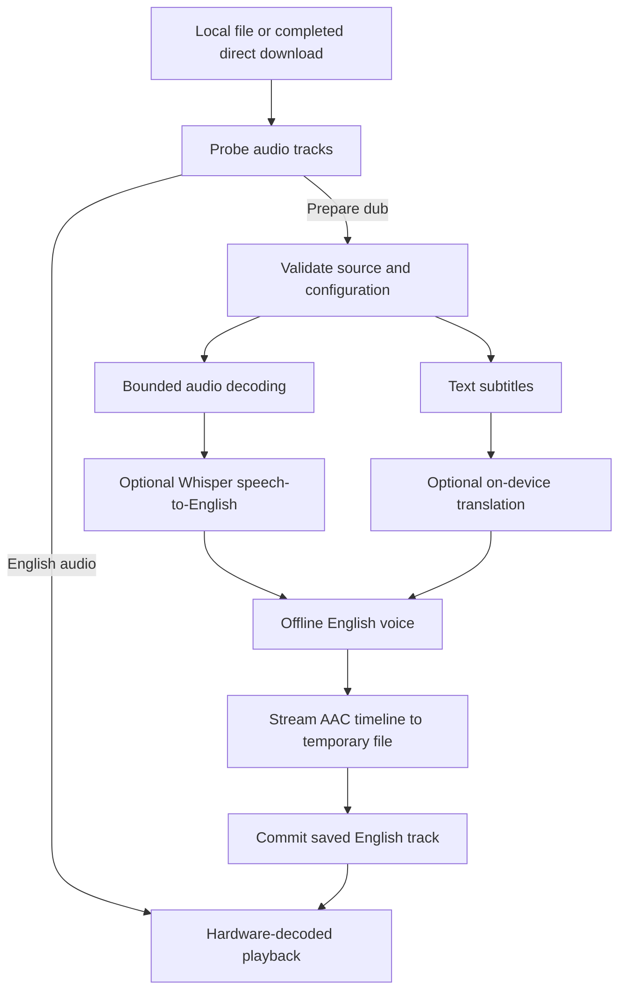

# Architecture

EnglishDub is one Kotlin/Android Views application. It has no web runtime, account system, inference backend, or video re-encoding step.

## Boundaries

- **UI:** a persistent header and RecyclerView library. Room emits library changes; a diff updates changed cards. Offline setup rebuilds only on navigation or completed setup operations. Status updates do not reconstruct the library.
- **Admission:** `PreparationCoordinator` reserves a numbered owner before requesting Android service startup. A stale task cannot release a newer reservation. The service clears its running task before publishing idle and uses its start ID during shutdown.
- **Recognition:** `DialogueRecognizer` owns a model and accepts an exclusively borrowed direct audio buffer. Decode/inference are sequential; cancellation aborts native work and joins it before closing model memory or reusing the buffer.
- **Translation and speech:** `TextTranslator` and `VoiceSynthesizer` are narrow interfaces. Translators and TTS shut down before the AAC stage. Voice identity includes engine and voice selection.
- **Audio:** MediaExtractor/MediaCodec decode only audio for recognition. Mono 16 kHz data is resampled incrementally in bounded 30-second windows. Source timestamps, gaps, and resume offsets are preserved.
- **Encoding:** MediaCodec encodes fixed-rate mono AAC. Silence and individual speech files are fed incrementally into one audio timeline. No movie-sized PCM soundtrack or re-encoded video is produced.
- **Playback:** video is the master clock; a second Media3 player handles the saved dub. Events synchronize immediately. A two-second settling interval uses 100 ms checks after startup, resume, seek, or speed changes; stable playback uses 250 ms checks. Paused/backgrounded players do not poll. The 150 ms clock target remains a device acceptance gate.

## Durable work and caches

Room schema version 2 adds nullable preparation and voice signatures through an explicit 1→2 migration. Existing completed entries remain watchable. Interrupted old jobs regenerate incompatible temporary work.

Recognition segments and the decoded offset commit together. Translated text and synthesized cue metadata commit at cue completion. Display progress can lag by up to about a second without losing completed recognition/cue work.

The preparation signature includes sampled seekable source identity, subtitle content, source language, mode, recognition/model configuration, VAD setting, and pipeline version. Source identity samples the first and last 64 KiB plus URI, size, and available modification metadata; it is a cache identity check, not a full-file integrity hash. Non-seekable or unknown-size sources are not assumed reusable. Voice changes invalidate synthesized audio while preserving compatible recognition and translations.

Translation memoization is limited to 128 entries. Speech files are scoped to one job and keyed by text, voice, pipeline, and rate. A completion marker and PCM length protect against using interrupted files. Scratch WAV/PCM data is deleted after final AAC commitment. Interrupted AAC encoding restarts from retained cue audio.

## Resources and failure paths

An existing English track returns before voice/model/storage preparation requirements. All other paths remain single-job. Large AI contexts close between stages; the shared object can remain mapped while its model allocations are freed.

Time/byte gates reduce storage syscalls. Database writes update only progress/state columns during reporting. File write failures still stop work immediately. Disk estimates are approximate; generated speech length and filesystem quotas can differ from subtitle timing and advertised free space.

User pause, session limits, Android service timeout, and severe thermal status save existing checkpoints and release foreground/wake-lock resources. Actual device behavior and unsupported flows are reported in validation rather than inferred from host builds.

The vendored Whisper scheduler has a small, documented cancellation-propagation patch. See `app/src/main/cpp/vendor/whisper/ENGLISHDUB_PATCHES.md` when upgrading upstream.
